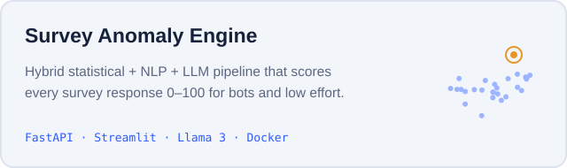
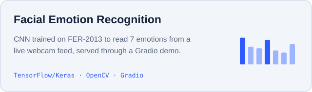
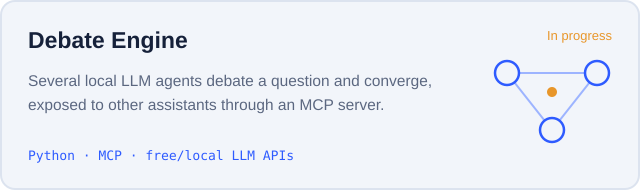

<picture>
  <source media="(prefers-color-scheme: dark)" srcset="assets/header-dark.svg">
  
</picture>

I'm a final-year Computer Engineering student at Istanbul Medeniyet University (graduating June 2027), working on applied AI: LLM pipelines, multi-agent systems and MCP. I like problems where messy real-world signals have to become a decision, such as noisy survey answers, the echo of a room, or a group of language models that disagree.

Right now I'm turning my multi-agent debate engine into an open-source MCP server, receiving technical mentorship at **IBM** on watsonx, IBM Bob and multi-agent systems, and looking for an **AI/ML internship** for 2027.

### Selected work

<a href="https://github.com/saruhangorkem/survey-anomaly-engine"><picture><source media="(prefers-color-scheme: dark)" srcset="assets/survey-dark.svg"></picture></a>
<a href="https://github.com/saruhangorkem/roomtune_core"><picture><source media="(prefers-color-scheme: dark)" srcset="assets/roomtune-dark.svg"></picture></a>
<a href="https://github.com/saruhangorkem/Emotion_Recognition_Project"><picture><source media="(prefers-color-scheme: dark)" srcset="assets/emotion-dark.svg"></picture></a>
<picture><source media="(prefers-color-scheme: dark)" srcset="assets/debate-dark.svg"></picture>

### Experience

| Role | What I did |
|---|---|
| **AI Intern**, VeriSimple  Aug – Sep 2026 | Designed and built VIA-Engine, a pipeline that flags anomalous and bot-generated survey responses using FastAPI, Shannon entropy and Llama 3 on Groq. |
| **Technical mentorship**, IBM  Jun 2026 – present | Mentored by an IBM Customer Success Engineer on watsonx, IBM Bob, AI automation, system integration and multi-agent systems. |
| **Web Developer & Project Manager**, Company Clinic  May 2026 – present | Built [companyclinic.com.tr](https://companyclinic.com.tr), a B2B corporate consultancy platform, end to end: GSAP animations, PHP contact flow and database integration. |
| **Freelance Software Developer**, Nexora Labs  Jun – Aug 2025 | Shipped Python/Selenium automation bots that saved about 15 hours of manual data entry a week, plus web apps and admin panels for small businesses. |

### Research, ventures and recognition

- **TÜBİTAK 2209-A research grant** for an AI-assisted learning platform that teaches algorithms through interactive flowcharts and a multi-agent tutor.
- **Pixie**, co-founder: a Stable Diffusion/LoRA pipeline generating grid-aligned 2D game assets, with LLM + RAG (pgvector) prompt optimization. Accepted to Boğaziçi Teknopark's BİGG+ acceleration program.
- **Roomtune**, founding team: acoustic optimization startup, accepted to YTÜ Startup House pre-incubation.
- **Medeniyetekno**, club president (2025–2026): produced and hosted the club's technology podcast with industry guests.

### Toolbox

Also: LLMs and RAG, multi-agent systems, MCP, IBM watsonx, NLP, computer vision, Stable Diffusion/LoRA, multi-tenant SaaS architecture, TCP sockets and multithreading in C.

<picture>
  <source media="(prefers-color-scheme: dark)" srcset="https://raw.githubusercontent.com/saruhangorkem/saruhangorkem/output/snake-dark.svg">
  
</picture>
